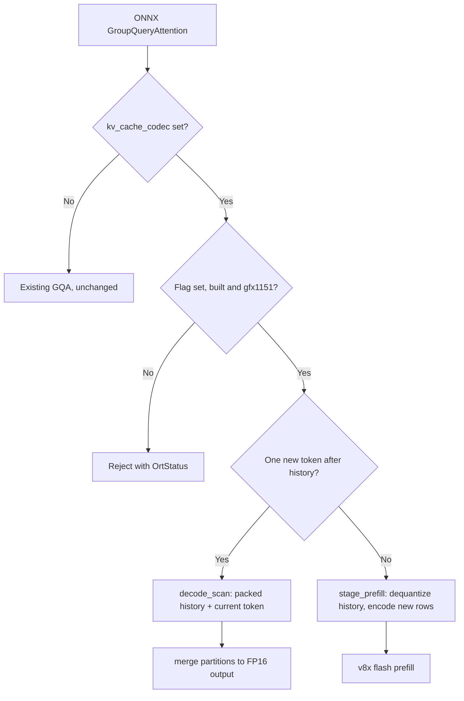

<!--
Copyright (C) 2026 Advanced Micro Devices, Inc. All rights reserved.
Licensed under the MIT License.
-->
# Experimental KV-Pareto KV-cache compression for Strix Halo

KV-Pareto ([paper](https://aclanthology.org/2026.eacl-industry.9/)) stores the
GQA KV cache in compressed form inside the graph's own past/present tensors.
This implements its **per-token** K8V8 codec, `k8v8_g32_planar_v1`: INT8 K and
V with one BF16 scale and one INT8 zero point per token, KV head and group of 32
channels. The **per-block** variant is work in progress.

## Enabling

KV-Pareto is compiled by default (`HIP_EP_ENABLE_KV_PARETO=ON`), but inference
uses existing GQA unless the process opts in before it starts:

```powershell
$env:HIPDNN_EP_USE_KV_PARETO = "1"
```

On Linux, use `export HIPDNN_EP_USE_KV_PARETO=1`. Only the value `1` enables
it, and it is read once per process. `HIP_EP_ENABLE_KV_PARETO=OFF` excludes it
from the build; after changing the option, rebuild the runtime and kernels
together and regenerate model compilation caches. This follows the opt-in
pattern of Ring attention ([PR #1366](https://github.com/ROCm/hip-ep/pull/1366)).

With the flag set, a session selects the codec with provider options:

```json
{"kvCacheQuantizationBits": "8", "kv_cache_codec": "k8v8_g32_planar_v1"}
```

The graph keeps the stock `com.microsoft::GroupQueryAttention` node. The caches
are `[1, 4, C, 140]` FP16 carriers, so the compiler lowers the node to
`wrap_group_query_attention_v2`, which adds the physical cache widths. Calls
without `kv_cache_codec` are unchanged. A codec request is rejected with an
`OrtStatus`, never redirected, when the flag is unset, KV-Pareto is not built or
the device is unsupported. The application allocates the 140-wide caches;
onnxruntime-genai 0.17 needs a change to size them from `kv_cache_codec`, which
is not part of hip-ep.

## Cache format

Each cache tensor is one planar block of `4 * C * 280` bytes:

| Region | Shape | Bytes per token and KV head |
| --- | --- | ---: |
| INT8 codes | `[4][C][256]` | 256 |
| BF16 scales | `[4][C][8]` | 16 |
| INT8 zero points | `[4][C][8]` | 8 |

```text
scale = bf16(max(bf16(max - min), bf16(1e-6)) / 255)
zero  = clamp(-128 - rint(bf16(min / scale)), -128, 127)
code  = clamp(rint(bf16(x / scale)) + zero, -128, 127)
x'    = (code - zero) * scale
```

That is 45% less KV memory than FP16 (280 instead of 512 bytes per token and KV
head). Rows are not self-contained, so beam reordering and row trimming are
unsupported.

## Implementation

`gqa.cpp` validates the contract, reserves the runtime workspace and resolves
the prefill launch config with the dense path's policy. Everything else is in
`lib/Runtime/Kernels/hip/kv_pareto/kv_pareto_k8v8.hip`, behind
`hip_kv_pareto_k8v8_gqa`:



- **Decode** (one new token): `decode_scan` streams the packed history once per
  KV group in 32-token tiles, dequantizes each tile into LDS and computes scores
  and P.V on WMMA with FP32 accumulation. It also attends to the current token
  from its FP16 K/V and writes that token's packed row. `merge` combines the
  partitions, sized to one full wave of resident blocks.
- **Prefill and append:** `stage_prefill` dequantizes the history into an FP16
  workspace, copies the new K/V and encodes them into the cache in one pass;
  hip-ep's v8x flash prefill then attends over that stage. Old packed rows are
  never rewritten.

Both attend to the dequantized history plus the new tokens at FP16, then store
the new tokens packed.

## Supported contract

- gfx1151 (Strix Halo). The kernels are compiled into the `gfx1151` and
  `gfx11-generic` libraries behind a gfx1151 device guard; other kernel slices
  export stubs.
- Batch 1, 4 KV heads, head dimension 256, 16 or 24 query heads, FP16, separate
  Q/K/V, causal attention, external RoPE; no bias, sinks, window, softcap or QK
  output.
- Shared past/present buffers of width 140. Capacity is at most 262,272 tokens,
  with at most 262,144 new tokens per call (the same bounds as Ring).
- Workspace: prefill needs `2 * (past + new) * 4 * 256 * 2` bytes (1 GiB at
  256K); decode needs `H * partitions * 258 * 4` bytes.

## Validation

CI runs one kernel unit test, `unit_test/gqa/kv_pareto/Xfp16_Wi8_Yfp16`, in the
existing kernel-test job on Strix Halo. It calls the packaged kernels without
the runtime flag, checks the encoder bit-exactly, checks prefill, append and
decode for H16 and H24 against FP64, and checks the whole cache byte-exact after
every call. Coverage tiers 2/3 extend to the bounds, including a single-call
256K prefill. Other GPUs skip it.

On demand, `test/numeric/tests/test_gqa_kv_pareto.py` runs the GQA node through
ORT: without the flag it checks the rejection and the unchanged dense path; with
`HIPDNN_EP_USE_KV_PARETO=1` it runs multi-turn schedules against an FP64 oracle.
LIT `hip-to-llvm/test_gqa_packed_cache_width.mlir` checks the `_v2` lowering.
