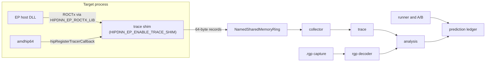

<!--
Copyright (C) 2026 Advanced Micro Devices, Inc. All rights reserved.
Licensed under the MIT License.
-->
# Performance toolkit design (Windows)

`tools/perf-harness` is the performance toolkit for hip-ep on Windows. It is a
Python package (`hipep_perf`) plus one native piece, the trace shim, which is
compiled only into profiling builds. This document covers the design and the
contracts between the pieces; the user guide is
[tools/perf-harness/README.md](../../tools/perf-harness/README.md).

## Principles

- Only uninstrumented TTFT and decode throughput, measured as an interleaved
  A/B, decide whether a change ships. Every other measurement ranks candidates.
- Every measurement layer is checked against a ground truth before anything
  downstream relies on it (see [Ground truth](#ground-truth)).
- The shipped binary is unaffected. The trace shim is a CMake option that is
  off by default; with it off the EP DLL, `runtime.bc` and the custom-kernel
  DLLs contain none of it.

## Components

| Module | Role |
|---|---|
| `lib/Runtime/trace_shim.cpp` | Native shim (profiling builds only) |
| `hipep_perf.bench`, `ab`, `stats` | Clean TTFT/TPS runs and the interleaved A/B with paired statistics |
| `hipep_perf.collector`, `ring` | Drains the shim's ring into a journal |
| `hipep_perf.trace`, `traced` | Journal to tables, attribution, report, Chrome JSON and `.pftrace` |
| `hipep_perf.rocprof` | rocprofv3 (ROCm 7.2.1) export: CSVs, `results.json`, `--stats` tables |
| `hipep_perf.ktrace_ref` | ktrace output and raw spools as traces (reference and parity) |
| `hipep_perf.rgp` | `.rgp` decoder (replaces `tools/rgp_parser`) |
| `hipep_perf.capture` | RGP capture positioned by the shim's fence |
| `hipep_perf.calib` | Ground-truth calibration workload and its scoring |
| `hipep_perf.analysis` | Headroom, decode model, SQTT calibration, host timeline, ROCTx attribution |
| `hipep_perf.ledger` | Predicted versus measured gains |

## Trace shim

### Build gate

`-DHIPDNN_EP_ENABLE_TRACE_SHIM=ON` adds `trace_shim.cpp` to the
`hipdnn-ep-tls` archive, which the EP host DLL (and native model DLLs) already
link. `roctx_shim.cpp` references the shim under `HIPDNN_EP_TRACE_SHIM`, which
keeps its object in the link. The shim reaches HIP only through
`GetProcAddress`, so it adds no link dependency, and it touches neither
`runtime.bc` nor the custom-kernel DLLs: the runtime's op sites already call the
host-side ROCTx bridge, which is where the shim plugs in. The option is
Windows-only and rejected with the mock runtime.

### ROCTx sink

The shim exports `roctxRangePushA`, `roctxRangePop` and `roctxMarkA` from the
DLL that links it. Both ROCTx bridges (`lib/Runtime/roctx_shim.cpp` for op
ranges and marks, `morphizen/ort-bridge/src/roctx-range.hpp` for subgraph
ranges) load `HIPDNN_EP_ROCTX_LIB`, so pointing that at the profiling build's
`hipgpu.dll` routes every range to the shim with no code change in either
bridge. The shim returns -1 (no range) unless it is collecting or a fence is
configured.

### HIP activity

At DLL load the shim registers `hipRegisterTracerCallback`. The runtime reports
every completed GPU command (dispatch, copy, barrier) with its own begin and end
timestamps. The HIP API domain supplies the correlation ids that tie a command
to the call and thread that issued it; the shim sets the id itself and installs
only `phase_exit`, so no call arguments are marshalled. That domain is armed
only if the runtime's `hipApiName` table matches the compiled
`hip_prof_str.h` for every id, because `hip_api_data_t` is sized by that
enumeration and the runtime writes the shim's callback pointer after it. The
result of the check is in the ring header (`api_detail`).

`hipRegisterTracerCallback` holds one callback, so the shim and another tracer
that uses it (ktrace's injected tracer) cannot run in the same process.

### Op fence

`HIPEP_TRACE_FENCE=<op>` arms a one-shot fence on the push of
`hip_ep.op.<op>`. It counts Runs from subgraph pushes (`hip_ep.graph.* sub=0`,
or `HIPEP_TRACE_FENCE_GRAPH`), waits for Run `HIPEP_TRACE_FENCE_AFTER_RUNS`,
lets `HIPEP_TRACE_FENCE_SKIP` instances pass, then drains the GPU, prints
`[RGP_FENCE_ARMED]` and idles `HIPEP_TRACE_FENCE_MS`. With
`HIPEP_TRACE_SQTT_MARKER=1` it first launches `hipep_trace_sqtt_marker`, an empty
kernel compiled once through the hiprtc beside the loaded runtime, on the
session stream, so a trace window keyed on a kernel name opens exactly there.

### Ring

The collector creates the named mapping `Local\hipep_trace_<session>` before
the target starts and passes the session in `HIPEP_TRACE`; the shim attaches at
load. A 4 KiB header (magic `PIEPETR1`, version, capacity, QPC frequency,
producer pid, flags, API check result, then `head`, `tail` and `dropped` on
their own cache lines) precedes `capacity` 64-byte records. Producers reserve a
slot with a compare-and-swap on `head`, fill it and publish `seq = position + 1`;
a full ring drops the record and counts it rather than blocking a runtime
thread. The collector reads committed slots in order and publishes `tail`
with a single aligned 8-byte store: a producer that read a torn `tail` would
see a full ring once positions pass the capacity (this dropped records on long
runs until `ring.py` stopped writing it with `struct`).
Because the collector lives in another process, committed records survive any
kind of target exit. `lib/Runtime/trace_shim.cpp` and `hipep_perf/ring.py`
must change together; bump the version on any layout change.

Record types: GPU command (correlation id, begin, end, queue, kind/op/device,
kernel name id or byte count), API call (correlation id, enter, exit, API id),
range push/pop, mark, name chunk (40 bytes of text per record), fence, and one
device summary (name, architecture, CUs, wave size, threads and LDS per CU,
clocks) sent with the first range push. Host
timestamps are QPC nanoseconds, the clock the Windows HIP runtime stamps
commands on; `trace.validate` checks that no command starts before the call
that issued it.

### Attribution

A command is charged to the innermost range open on the issuing thread at the
moment of the HIP call, found by correlation id. Host time alone cannot be used:
GPU work runs after the range that enqueued it has closed.

## RGP decoder

`hipep_perf.rgp` decodes RDP-produced captures and is meant to read the RGP
files ktrace's patched runtime writes. It keeps the algorithms of the decoder it
replaces, since those are the specification (a port of rocprof-trace-decoder's
gfx11 token parser, RGP's SQTT marker layouts from Mesa's `ac_sqtt.h`, PAL's
SPM chunk layout), with stdlib `compression.zstd` instead of `zstandard` and its
own ELF symbol reader instead of `pyelftools`. Its outputs keep the previous
schemas, so the analysis scripts read either.

SPM is the one place it departs from the previous decoder, because the
calibration workload showed that decoder wrong in two ways:

- The SPM buffer is a ring. When a capture outlasts it, it keeps the most
  recent samples, but the previous decoder pinned the first sample to the first
  dispatch. Samples are now placed by the shared 100 MHz counter; SQTT's
  realtime base agrees with SPM's timestamps only in the low 32 bits, so the
  offset is taken modulo 2^32 ticks.
- EA event 55 counts 32-byte requests on gfx1151, not 64-byte ones: read,
  write and copy kernels of known size measured 2.0x their bytes at 64 B.

On a 16K decode capture the two fixes move 483 of 580 "memory-bound"
dispatches out of that class. `rgp parity` decodes SPM the old way
(`build(..., legacy_spm=True)`), so the byte-identical comparison still covers
the rest of the decoder.

## rocprofv3 export

`hipep_perf.rocprof` writes what ktrace's C++ `finalize` writes, with its
conventions: agent_info, hip_api_trace, kernel_trace (mangled names) and
kernel_trace_readable (comgr-demangled labels and the RGP dispatch index),
memory_copy_trace, memory_allocation_trace, roctx_trace, results.json, and the
rocprofv3 `--stats` tables. The shim does not marshal call arguments, so fields
that come from them are written as ktrace writes them without
`KTRACE_API_ARGS`: stream 0, launch geometry 0, allocation size and address 0.
Dispatch ids follow the runtime's reporting order and kernel ids first
appearance. `ktrace_ref.load_spool` reads ktrace's raw spool, so the same code
finalizes ktrace captures (`trace finalize-ktrace`) and ktrace's C++
postprocessor is not needed.

## Ground truth

| Layer | Ground truth |
|---|---|
| End to end | Uninstrumented TTFT/TPS in an interleaved A/B with one reversed block; rounds with more than 5% stalled decode tokens are flagged as host noise and compared on fast-decile ms/token instead of the mean |
| Runner | A/A run (identical arms) must give an interval that includes zero |
| Kernel timestamps | `calib/hipep_calib.hip`: spin kernels of exact duration on the constant-rate wall clock |
| Attribution | Calibration kernels must land in the ROCTx phase that launched them |
| Clocks | No command may start before its HIP call |
| RGP decoder | Byte-identical outputs to the frozen previous decoder on a capture corpus of RDP- and ktrace-produced captures (SPM decoded the old way); spin kernels within 2 us of truth (`calib rgp`) |
| SPM | Bytes SPM attributes to each calibration read, write and copy kernel within 5% of the bytes it moves (`calib rgp --counters`) |
| ELF reader | Identical symbols to `pyelftools` on every corpus code object |
| rocprofv3 export | Passes ktrace's ROCm 7.2.1 validator; byte-identical to ktrace's C++ finalize on the same raw spool (every CSV, every `results.json` section) |
| Analysis | The prediction ledger: predicted gain against measured A/B gain |
| Op map | Derived from ROCTx attribution (`roctx_attrib --emit-map`); must agree with it on the traces it came from |

Kernel durations can only be compared with ktrace when both runs are lightly
perturbed: with its HIP API domain on, ktrace slowed Laguna-XS-2.1 decode
about 2.2x and the GPU, running between longer host gaps, took 1.7-2.7x longer
per kernel. With `KTRACE_NO_API=1` against `trace run --no-api`, kernels of at
least 5 us agree within 0.7% (time-weighted). Dispatch and call counts must
match on any pair of runs; ktrace cuts kernel names at 255 characters.

hipEvent pairs are recorded beside each calibration kernel as a second source,
not as truth: on gfx1151 a 10 us kernel can read anywhere from 1 to over 100 us
through an event pair.

## Limits

- The patched HIP runtime that adds SPM streaming and in-process SQTT windows
  is ktrace's (`patches/clr-spm`); it is not part of this repository and has
  been tested only on gfx1151. Without it, `capture --inproc-sqtt` and
  whole-run SPM (ktrace `--spm`) are unavailable; SPM comes from RGP captures
  with `--counters` instead. Neither path has been exercised by this toolkit.
- The op map comes from the models traced for it (`analysis/op_families.json`:
  Laguna-XS-2.1 decode and prefill). A model that launches other kernels needs
  its own: trace it and run `analysis roctx_attrib <trace> --emit-map`.
- The SQTT marker hangs Radeon Developer Panel captures on gfx1151 (the
  target spins and the trace never starts), so `capture` launches it only for
  `--inproc-sqtt`. A panel capture needs no marker: the fence alone opens its
  window at the fenced op.
- The HIP API domain depends on the loaded runtime matching the compiled HIP
  headers; when it does not, commands are still traced but not attributed.
- Traced runs carry the shim and per-op labels, so their throughput is not a
  measurement. On Laguna-XS-2.1 decode (gfx1151, 128 tokens) collecting cost
  about 10-13% per token. With the shim compiled in but idle, with or without
  ROCTx routed to it, an interleaved A/B against the shipped build found no
  difference (95% intervals of -0.20..+0.65 and -0.18..+0.37 ms on 14.1
  ms/token).
