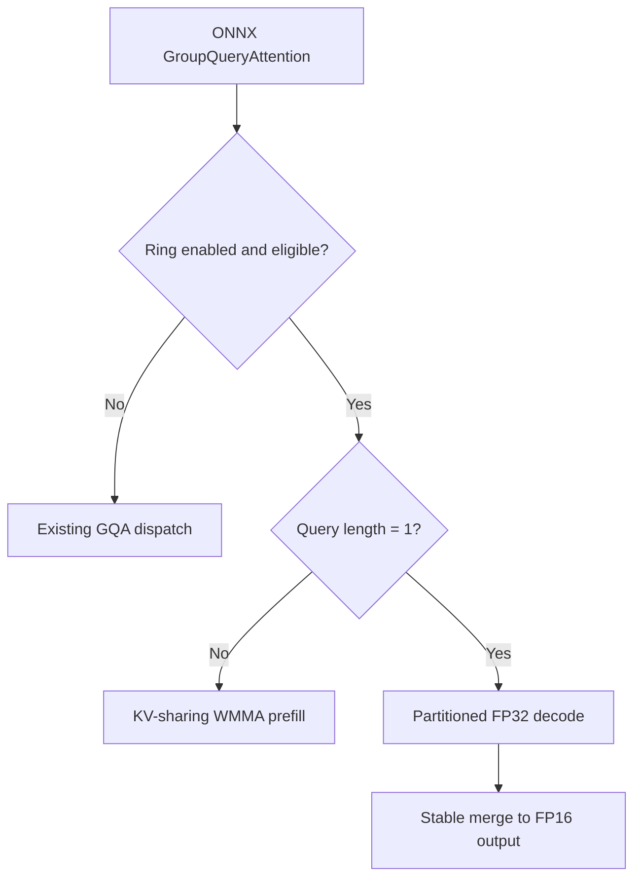

<!--
Copyright (C) 2026 Advanced Micro Devices, Inc. All rights reserved.
Licensed under the MIT License.
-->
# Experimental Ring attention for Strix Halo

Ring is compiled into normal builds by default (`HIP_EP_ENABLE_RING_ATTENTION=ON`), but inference uses existing GQA unless explicitly opted in. Set this environment variable before starting the inference process:

```powershell
$env:HIPDNN_EP_USE_RING_ATTENTION = "1"
```

On Linux, use `export HIPDNN_EP_USE_RING_ATTENTION=1`. Unset the variable or set it to `0` to retain existing GQA. Only the exact value `1` enables Ring; the setting is cached on first use. Switching dispatch does not require rebuilding or recompiling models compiled with Ring support included. Older model compilation caches must be regenerated once to include the FP16 Ring entry point.

`HIP_EP_ENABLE_RING_ATTENTION=OFF` excludes Ring from the build entirely. The former three-way `HIP_EP_GQA_IMPL` option is removed and rejected at configuration. Rebuild/install the compiler, runtime and native kernels together when changing build options. The ONNX interface and original GQA ABI remain unchanged.

Ring supports Strix Halo (`gfx1151`). Its kernels are built into the dedicated `gfx1151` and release `gfx11-generic` libraries. Even with runtime opt-in, other GPUs and unsupported attention contracts retain existing GQA. Broader hardware support requires separate validation.

## Supported contract

Ring targets gfx1151 with FP16 separate Q/K/V, batch 1, 24 query heads, four KV heads, head dimension 256, scale 1/16, external RoPE and causal attention. It accepts 1..262144 new tokens and at most 262272 valid KV tokens (256K plus 128 outputs). Cache capacity may exceed the valid length. Q/output use BSHD and the prepared present cache uses BNSD. Selection and writable-range validation occur before cache mutation; the existing runtime stream is retained.

Other supported geometries, architectures, packed inputs, in-op RoPE, quantized caches, bias, windows and sinks retain existing GQA routing. The compiler selects `wrap_group_query_attention_ring_f16` only for eligible operations with proven FP16 query/key/value/output and cache types. BF16, FP32, mixed types and nonzero softcap keep the original `wrap_group_query_attention` entry point and its existing behavior. The original ABI is unchanged; enabling Ring introduces no additional rejection for these calls and does not add BF16 or softcap support to upstream GQA. The Ring entry point retains runtime shape and device guards and falls back to existing GQA when they do not match. No cache compression or model changes are introduced.

## Algorithms

- **Prefill (`query_length > 1`):** two 16-query consumers and six query heads share each staged 16-token KV tile. QK and ordinary PV use FP16 WMMA with FP32 accumulation and online softmax. Numerator probabilities are scaled by 32768 before FP16 conversion; smaller-than-normal scaled probabilities use FP32 PV residuals so a tiny probability times a large value is not lost. Final normalization removes the scale. No global score matrix or explicit global scratch is allocated.
- **Decode (`query_length = 1`):** one wave per query head, six waves per workgroup, share each KV tile. QK, natural-exponential softmax probabilities and weighted V stay FP32. Online rescaling is skipped when the running maximum does not change. Independent history partitions produce FP32 summaries; a stable merge writes FP16 output.
- Both paths use natural `expf`. The probability scale is an exact numerator scale, not a base-2 softmax reformulation. KV and output storage remain FP16.



| Valid KV tokens | KV tile | Decode partitions | Explicit global scratch |
| --- | ---: | ---: | ---: |
| 1..32 | 16 | 1 | 0 B |
| 33..128 | 16 | 4 | 99,072 B |
| 129..1,024 | 16 | 8 | 198,144 B |
| 1,025..8,192 | 16 | 24 | 594,432 B |
| 8,193..65,664 | 8 | 48 | 1,188,864 B |
| 65,665..262,272 | 8 | 96 | 2,377,728 B |

Workspace sizing and launch dispatch use the same helper. Scratch is runtime-owned and reused. This policy is specific to this GPU and geometry; these are single-GPU tiled kernels without distributed transport.

## Validation

Windows CI builds one package containing GQA and Ring. The existing kernel unit-test job runs one Ring executable on Strix Halo, directly calling the packaged kernels without enabling Ring for model inference. Its short tier covers prefill, decode, partition boundaries, workspace sizing and probability precision. Coverage tiers 2/3 extend through 128K/256K. The existing kernel-change filter controls PR execution; there is no second EP build or unconditional Ring ONNX job. Other architectures do not run this gfx1151-only kernel test.

The full ONNX suite remains available on demand. This command explicitly opts its child process into Ring and requires zero skips/failures plus diagnostics proving prefill and decode dispatch:

```powershell
python test/numeric/run_ring_ci.py --package <gpu-test-package> --output ring-results
```

For manual application checks, set `HIPDNN_EP_USE_RING_ATTENTION=1` and `HIPDNN_EP_STRICT=1`, disable ORT CPU fallback, and temporarily enable `HIPDNN_EP_DEBUG=1` to confirm `Ring GQA q=... past=... capacity=...` dispatch. Disable debug for timing. Numeric tests cover geometry, cache aliasing, prefill/decode transitions, partition boundaries, long contexts and probability underflow. LIT tests check FP16 selection and unchanged fallback routing with Ring ON and OFF. Kernel checks alone do not establish full-model accuracy or performance.

See [PR #1366](https://github.com/ROCm/hip-ep/pull/1366) for benchmark tables, hardware, model, accuracy, timing and memory scope, and links to the archived measurement data. Each benchmark retains its recorded source revision and build configuration.

The kernels derive from contributor-supplied METIS exports, authorized for MIT contribution. WMMA score ownership and V swizzle also derive from hip-ep v8x (MIT).
