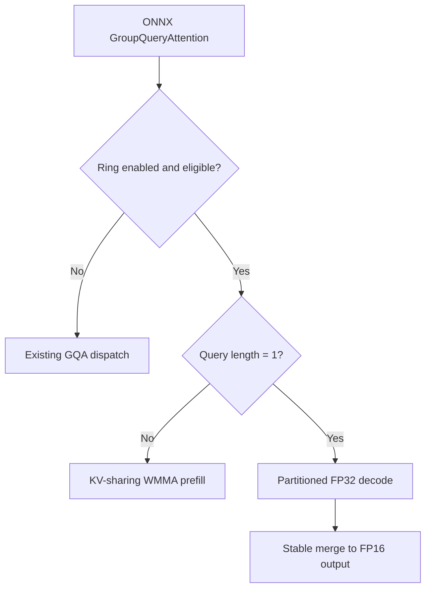

<!--
Copyright (C) 2026 Advanced Micro Devices, Inc. All rights reserved.
Licensed under the MIT License.
-->
# Experimental Ring attention for Strix Halo

`HIP_EP_ENABLE_RING_ATTENTION=ON` enables one Ring implementation with KV-sharing prefill and partitioned decode. The default is `OFF`, preserving existing GQA. The former three-way `HIP_EP_GQA_IMPL` option is removed; configuration rejects it rather than silently building the default.

```bash
python3 build.py --config Release --hip_arch gfx1151 \
  --build_dir ../build/hip-ep-ring --install_dir ../install/hip-ep-ring \
  --cmake_extra_defines HIP_EP_ENABLE_RING_ATTENTION=ON
```

Rebuild/install the compiler, runtime and native kernels together. Point the application at that installation's EP library and configuration, and use a fresh model compilation cache when switching builds. The ONNX GroupQueryAttention interface, runtime signature, cache layout and cache-update helper are unchanged. This is a build-time option, not an environment-variable selector.

The supported hardware is Strix Halo (`gfx1151`). Ring is compiled for both the dedicated `gfx1151` target and `gfx11-generic`, which includes Strix Halo in the release package. In either build, the runtime device guard enables Ring only on `gfx1151`; other GPUs retain existing GQA routing. The build option remains OFF by default. Broader Ring hardware support requires separate validation.

## Supported contract

Ring targets gfx1151 with FP16 separate Q/K/V, batch 1, 24 query heads, four KV heads, head dimension 256, scale 1/16, external RoPE and causal attention. It accepts 1..262144 new tokens and at most 262272 valid KV tokens (256K plus 128 outputs). Cache capacity may exceed the valid length. Q/output use BSHD and the prepared present cache uses BNSD. Selection and writable-range validation occur before cache mutation; the existing runtime stream is retained.

Other supported geometries, architectures, packed inputs, in-op RoPE, quantized caches, bias, windows and sinks retain existing GQA routing. Ring builds reject nonzero softcap during HIP-to-LLVM lowering, before emitting a runtime call, because neither route implements it. This also applies to FP32 and other fallback configurations; zero or omitted softcap remains accepted. They also reject BF16 and mismatched unquantized cache types: the existing runtime ABI conveys element width, which cannot distinguish BF16 from FP16. FP32 retains its existing route. No cache compression or model changes are introduced.

## Algorithms

- **Prefill (`query_length > 1`):** two 16-query consumers and six query heads share each staged 16-token KV tile. QK and ordinary PV use FP16 WMMA with FP32 accumulation and online softmax. Numerator probabilities are scaled by 32768 before FP16 conversion; smaller-than-normal scaled probabilities use FP32 PV residuals so a tiny probability times a large value is not lost. Final normalization removes the scale. No global score matrix or explicit global scratch is allocated.
- **Decode (`query_length = 1`):** one wave per query head, six waves per workgroup, share each KV tile. QK, natural-exponential softmax probabilities and weighted V stay FP32. Online rescaling is skipped when the running maximum does not change. Independent history partitions produce FP32 summaries; a stable merge writes FP16 output.
- Both paths use natural `expf`. The probability scale is an exact numerator scale, not a base-2 softmax reformulation. KV and output storage remain FP16.



| Valid KV tokens | KV tile | Decode partitions | Explicit global scratch |
| --- | ---: | ---: | ---: |
| 1..32 | 16 | 1 | 0 B |
| 33..128 | 16 | 4 | 99,072 B |
| 129..1,024 | 16 | 8 | 198,144 B |
| 1,025..8,192 | 16 | 24 | 594,432 B |
| 8,193..65,664 | 8 | 48 | 1,188,864 B |
| 65,665..262,272 | 8 | 96 | 2,377,728 B |

Workspace sizing and launch dispatch use the same helper. Scratch is runtime-owned and reused. This policy is specific to this GPU and geometry; these are single-GPU tiled kernels without distributed transport.

## Validation

Windows CI preserves the default-GQA packages, then rebuilds with Ring ON and publishes a separate library overlay. The Ring job runs the ONNX Ring regressions on the StrixHalo runner using the `gfx11-generic` library. It requires the runtime support query to succeed, zero skipped or failed cases, and runtime diagnostics confirming both Ring prefill and decode dispatch. Results and diagnostics are uploaded as `ring-test-results`. This validates Strix Halo only; it is not a hardware test matrix for other gfx11 devices.

Use `HIPDNN_EP_STRICT=1`, disable ORT CPU fallback, and temporarily enable `HIPDNN_EP_DEBUG=1` to confirm `Ring GQA q=... past=... capacity=...` dispatch. Disable debug for timing. Numeric tests cover geometry, cache aliasing, prefill/decode transitions, partition boundaries, long contexts and probability underflow. LIT tests check Ring-only type restrictions. Kernel checks alone do not establish full-model accuracy or performance.

See [PR #1366](https://github.com/ROCm/hip-ep/pull/1366) for benchmark tables, hardware, model, accuracy, timing and memory scope, and links to the archived measurement data. Each benchmark retains its recorded source revision and build configuration.

The kernels derive from contributor-supplied METIS exports, authorized for MIT contribution. WMMA score ownership and V swizzle also derive from hip-ep v8x (MIT).
