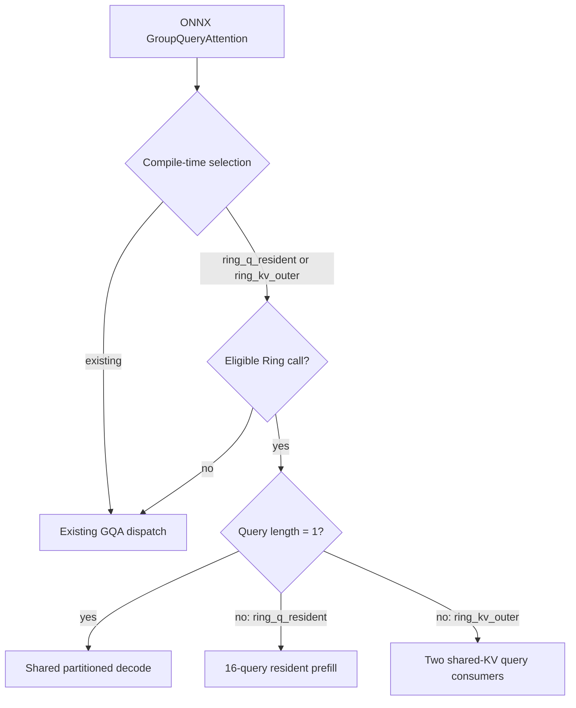
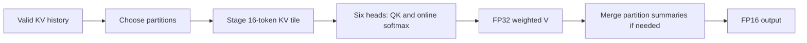

<!--
Copyright (C) 2026 Advanced Micro Devices, Inc. All rights reserved.
Licensed under the MIT License.
-->
# Experimental Ring attention

Configure `HIP_EP_GQA_IMPL` as `existing` (default), `ring_q_resident`, or
`ring_kv_outer`. The latter two select different prefill schedules and share a
partitioned Ring decode kernel. For example, pass
`--cmake_extra_defines HIP_EP_GQA_IMPL=ring_q_resident` to `build.py`.

The ONNX GroupQueryAttention interface, HIP dialect, runtime entry signature,
and cache-update helper are unchanged. Selection happens before cache mutation.
The Ring kernels only compute attention over the prepared present cache. There
is no Page attention, distributed transport, new ONNX operator, or runtime
selector in this implementation.

Ring accepts FP16 separate Q/K/V with external RoPE, B=1, 24 query heads,
4 KV heads, head dimension 256, scale 1/16, causal attention, 1..65536 new tokens,
and at most 65664 valid cache tokens (a 64K prompt plus 128 output tokens).
It targets a concrete gfx1151 build and checks the active device. Unquantized caches use BNSD layout; Q/output use BSHD.
Both prefill variants accumulate in FP32. Decode uses up to 396288 bytes of
runtime-owned scratch; prefill uses none. Calls use the existing runtime stream.

Decode shares each 16-token KV tile across six query heads, uses four waves
per workgroup and WMMA for QK, and merges FP32 partition summaries. Scores,
softmax probabilities and weighted V accumulation remain FP32; only final
outputs are rounded to FP16. Every wave reduces QK partials in the same order,
so all output slices share the same softmax denominator. The prefill schedules
are unchanged.

| Valid KV tokens | Partitions | Scratch bytes |
| --- | --- | --- |
| 1..32 | 1 | 0 |
| 33..128 | 4 | 99072 |
| 129..1024 | 8 | 198144 |
| 1025..65664 | 16 | 396288 |

The workspace query and launch use the same partition helper. This policy is
specific to gfx1151 and this geometry. A trial using FP16 probabilities for
WMMA PV failed the 64K full-model numerical check and is not included.

Other geometries, architectures, quantized caches, packed inputs, in-op RoPE,
bias, windows, and sinks retain existing GQA routing. Ring builds reject softcap
because neither existing route implements it. The compiler rejects BF16 and
mismatched unquantized cache element types in Ring builds: the unchanged runtime
ABI conveys element width, which cannot distinguish BF16 from FP16. FP32 keeps
its existing route. The `existing` build retains its previous behavior.

Invalidate model caches after changing the selection. Validate with
`HIPDNN_EP_STRICT=1`, CPU fallback disabled, and temporary `HIPDNN_EP_DEBUG=1`;
Ring dispatch reports the selection and lengths. Disable debug for timing.
Run `test_gqa_ring_geometry`, `test_gqa_ring_shared_cache_transitions`, and
`test_gqa_ring_long_context`, and `test_gqa_ring_decode_regimes` in the numeric suite against all three builds,
and the Ring-only dtype rejection LIT tests. Direct kernel checks do not
establish ONNX integration or a performance improvement.

The kernel is adapted from the METIS Ring exports, contributed under the MIT
license. WMMA score ownership and V swizzle also derive from hip-ep v8x (MIT).

## Algorithms and enablement

### Algorithms and regime selection

- **Existing:** preserve the current GQA dispatch and make it the default. The reported baseline is the actual ONNX/EP path for this model, including its existing fallback choices.
- **Ring-Q prefill:** each workgroup keeps one 16-query tile for six query heads resident, streams 16-token KV tiles through shared memory, and updates online softmax and output accumulators. QK/PV use WMMA with FP32 accumulation.
- **Ring-KV prefill:** two parallel 16-query consumers (32 queries per workgroup) and six query heads share each staged 16-token KV tile. Each consumer maintains its own online softmax/output state. This increases KV reuse across query tiles.
- **Shared decode, query length = 1:** stage each KV tile once for six query heads; four waves divide the 256-wide head dimension. Use WMMA QK with FP32 accumulation, FP32 softmax probabilities and FP32 weighted-V accumulation. Every wave reduces QK partials in the same order. Partition long histories and merge the FP32 summaries with stable softmax rescaling; round only the final output to FP16.
- These are single-GPU tiled schedules. There is no distributed ring transport. Neither prefill schedule materializes a global attention-score matrix or requests explicit global scratch.



The fallback in the figure applies to supported existing contracts. Ring builds explicitly reject softcap, BF16 and mismatched unquantized cache element types as described below.



| Valid KV tokens | Waves per scan workgroup | Partitions | Explicit global decode scratch |
| --- | --- | --- | --- |
| 1..32 | 4 | 1 | 0 |
| 33..128 | 4 | 4 | 99,072 B (96.75 KiB) |
| 129..1,024 | 4 | 8 | 198,144 B (193.5 KiB) |
| 1,025..65,664 | 4 | 16 | 396,288 B (387 KiB) |

Workspace sizing and launch dispatch use the same helper. Scratch is runtime-owned and reused; scan/merge run on the caller's stream without an added host allocation or synchronization.

## How to enable

Follow the repository Linux quick start for dependencies. From the hip-ep source directory, choose exactly one implementation and use a separate build/install directory for each comparison:

```bash
IMPL=ring_kv_outer  # existing | ring_q_resident | ring_kv_outer
python3 build.py --config Release --hip_arch gfx1151 \
  --build_dir "../build/hip-ep-${IMPL}" \
  --install_dir "../install/hip-ep-${IMPL}" \
  --cmake_extra_defines "HIP_EP_GQA_IMPL=${IMPL}"
```

The CMake equivalent is `-DHIP_EP_GQA_IMPL=ring_kv_outer`; invalid values fail configuration. Omitting the option retains `existing`. This is a build-time option, not an environment-variable selector.

Point the application at the matching installation's EP library and MorphiZen configuration. Rebuild/reinstall the compiler, runtime and custom kernels together, and use a fresh model compilation cache after switching. Keep the original ONNX model and its GroupQueryAttention nodes unchanged. For validation, enable `HIPDNN_EP_STRICT=1`, disable ORT CPU fallback (`session.disable_cpu_ep_fallback=1`) and temporarily enable `HIPDNN_EP_DEBUG=1` to confirm Ring dispatch. Disable debug for performance measurements.

See [Ring validation results](ring-attention-validation.md) for phase-specific performance, memory, accuracy and tested model scope.
