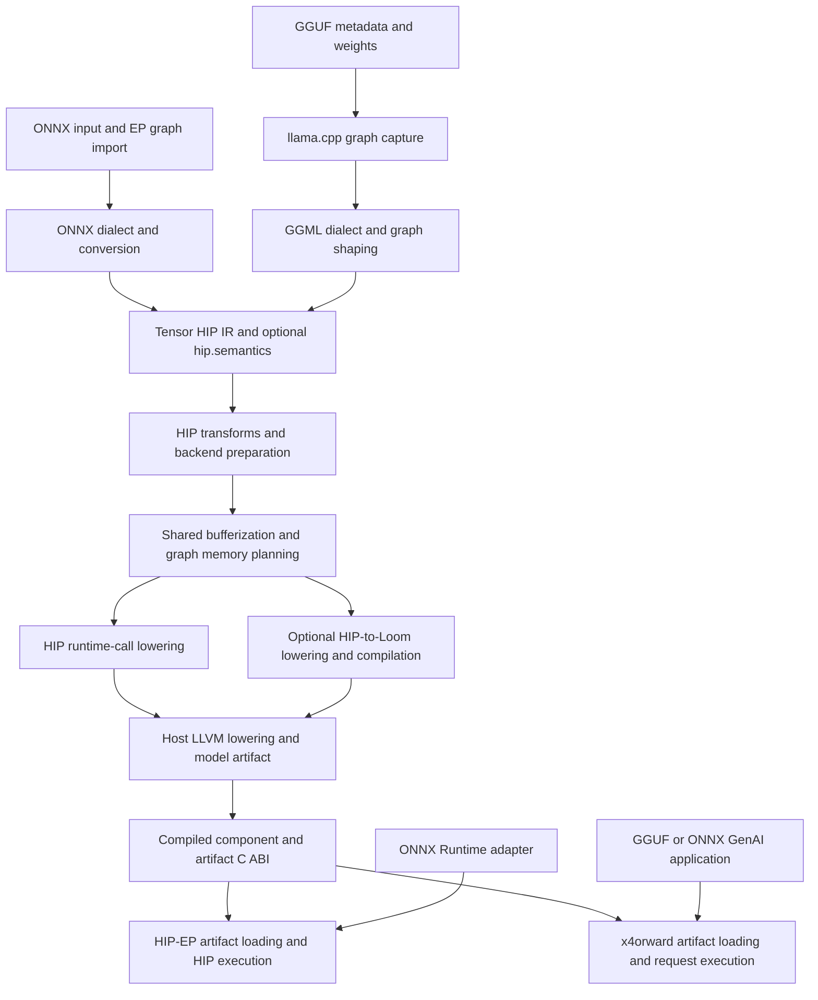

<!--
Copyright (C) 2026 Advanced Micro Devices, Inc. All rights reserved.
Licensed under the MIT License.
-->

# Proposed compiler source layout

Status: approved target layout, with mechanical implementation in progress.
The named HIP dialect directories and C API layout are implemented in this
checkout. Other destinations below remain planned. The first integration is
GGUF-to-HIP with the existing
HIP execution path. HIP-to-Loom is a later, optional backend integration.
See the [current source tree](../source-tree.md) for implemented ownership.

HIP-EP should provide a reusable compiler and runtime with an ONNX Runtime
execution-provider integration. A GGUF application should be able to use that
compiler without depending on the ONNX Runtime adapter. Frontends should share
HIP operation semantics, shape handling, bufferization and memory planning.
Backends should own their lowering, target selection and kernel compilation.

## References and inspected revisions

| Repository | Inspected revision | Relevant organization |
|---|---|---|
| MLIR (llvm-project) | [9631c90](https://github.com/llvm/llvm-project/tree/9631c90691806274165a460acd3e0942702c53e1/mlir) | Compiler component naming, C API headers and libraries, and test organization. |
| HIP-EP | [59377da](https://github.com/ROCm/hip-ep/tree/59377da40605dbdfe76b093eea3bd3195e8edc53) | Current upstream layout and dependencies. |
| HIP-EP-GGUF staging | [0cbadbb](https://github.com/AMD-AIG-AI-SOLUTIONS/HIP-EP-GGUF/tree/0cbadbbf8279db19179875f9804c60bcb4b94933) | Current GGUF/ONNX GenAI frontends, semantic interface, compiler plugins and x4orward runtime. |
| torch-mlir | [9dc56a0](https://github.com/llvm/torch-mlir/tree/9dc56a0e25d7b78878096866c5ce4d643f82e23f) | Dialect and conversion libraries, optional importers, registration and lit tests. |
| llama.cpp | [e14a779](https://github.com/ggml-org/llama.cpp/tree/e14a779719652200cec7ad58dfa4820edc347182) | Separate model, graph, backend and application components. |

torch-mlir provides the main compiler-layout reference:

- [Dialect IR](https://github.com/llvm/torch-mlir/blob/9dc56a0e25d7b78878096866c5ce4d643f82e23f/lib/Dialect/Torch/IR/CMakeLists.txt)
  has a library with explicit MLIR dependencies and generated-header dependencies.
- [Conversions](https://github.com/llvm/torch-mlir/blob/9dc56a0e25d7b78878096866c5ce4d643f82e23f/lib/Conversion/CMakeLists.txt)
  are grouped by source and destination. Optional TOSA and StableHLO lowerings
  are configured independently.
- [Optional projects](https://github.com/llvm/torch-mlir/blob/9dc56a0e25d7b78878096866c5ce4d643f82e23f/projects/CMakeLists.txt)
  gate importers and their framework dependencies. Python importers also exist;
  an importer does not have to be a C++ library.
- [Registration](https://github.com/llvm/torch-mlir/blob/9dc56a0e25d7b78878096866c5ce4d643f82e23f/lib/CMakeLists.txt)
  composes selected components. Individual dialect libraries do not depend on
  the register-everything library.

Upstream naming references are
[MLIR's C API library](https://github.com/llvm/llvm-project/tree/9631c90691806274165a460acd3e0942702c53e1/mlir/lib/CAPI),
[public C headers](https://github.com/llvm/llvm-project/tree/9631c90691806274165a460acd3e0942702c53e1/mlir/include/mlir-c)
and [test tree](https://github.com/llvm/llvm-project/tree/9631c90691806274165a460acd3e0942702c53e1/mlir/test).
torch-mlir follows the same split with
[`lib/CAPI`](https://github.com/llvm/torch-mlir/tree/9dc56a0e25d7b78878096866c5ce4d643f82e23f/lib/CAPI)
and [`include/torch-mlir-c`](https://github.com/llvm/torch-mlir/tree/9dc56a0e25d7b78878096866c5ce4d643f82e23f/include/torch-mlir-c).

llama.cpp provides a different, complementary reference:

- [The model library](https://github.com/ggml-org/llama.cpp/blob/e14a779719652200cec7ad58dfa4820edc347182/src/CMakeLists.txt)
  owns architecture-specific graphs, model loading and inference state, and
  depends on GGML.
- [GGML backend libraries](https://github.com/ggml-org/llama.cpp/blob/e14a779719652200cec7ad58dfa4820edc347182/ggml/src/CMakeLists.txt)
  are individually selectable. GGML separates its base library from backend
  registration and backend implementations.
- [Backend interfaces](https://github.com/ggml-org/llama.cpp/blob/e14a779719652200cec7ad58dfa4820edc347182/ggml/src/ggml-backend-impl.h)
  describe operation support, supported buffer types and execution.
- [Application tools](https://github.com/ggml-org/llama.cpp/tree/e14a779719652200cec7ad58dfa4820edc347182/tools)
  and common application helpers sit outside backend implementations.

These references support dependency boundaries. They do not prescribe every
directory name below. In particular, llama.cpp's runtime scheduler and dynamic
backend loader are not replacements for HIP-EP's compiler memory plan or static
MLIR plugin linkage. HIP-EP should retain one MLIR instance in the compiler.

## Current staging implementation

The [HIP-EP-GGUF staging repository](https://github.com/AMD-AIG-AI-SOLUTIONS/HIP-EP-GGUF/blob/0cbadbbf8279db19179875f9804c60bcb4b94933/docs/architecture.md)
is the source reference for the GGUF contribution. It has already reorganized
its compiler code under `lib/Dialect`, `lib/Conversion`, `lib/Frontend`,
`lib/Transforms/Semantics` and `lib/Plugin`, with matching public headers.
The older GGUF `src/Conversion` and `src/Execution` layout is not the migration
source for this proposal.

The staging implementation has two frontends: GGUF capture and ONNX GenAI
model description. It separates these compiler contributions:

| Staging component | Verified responsibility | Proposed HIP-EP owner |
|---|---|---|
| `lib/Plugin/Gguf` (`hip_ep_gguf`) | Registers GGML IR and its source-to-HIP pipeline. | GGUF frontend, GGML dialect and `Conversion/GgmlToHip`. |
| `lib/Plugin/HipGguf` (`hip_ep_gguf_kernels`) | Registers execution operations, shape/bufferization interfaces, LLVM lowering, wrapper bitcode and kernel dependencies; its registration has no model-format parsing. | `Dialect/HipGguf`, `Conversion/HipGgufToLLVM`, HIP wrappers and device kernels. |
| `lib/Plugin/Semantics` (`hip_ep_semantics`) | Checks and exports the shared component interface. | Optional shared semantic transforms and registration. |
| `lib/Plugin/OnnxGenAI` (`hip_ep_onnx_genai`) | Adds decoder-derived input lowering to the existing ONNX path. | ONNX frontend transforms. |
| `src/interface`, `include/hip_gguf/interface` | Schema, validator, interface data and artifact metadata used by frontends, compiler plugins and runtime. | A separately linkable, optional model-interface library. |
| `runtime/` | x4orward artifact loading, request state, media, generation, packaging and application C API. | A separate runtime consumer of HIP-EP artifacts; outside the first compiler upstream contribution. |

In staging, `hip.semantics` is a module attribute built from MLIR builtin
dictionaries and values. It is not a new MLIR dialect. Compiler passes validate
it against component tensors and emit JSON through the component's exported
`<prefix>hip_semantics_interface()` function. The runtime uses that interface
to interpret dynamic dimensions, input/output roles, state and component wires.

The [staging build](https://github.com/AMD-AIG-AI-SOLUTIONS/HIP-EP-GGUF/blob/0cbadbbf8279db19179875f9804c60bcb4b94933/CMakeLists.txt)
already selects compiler, frontends, runtime and development tools separately.
It builds the HIP compiler as an external project with static plugins. Its
[runtime library](https://github.com/AMD-AIG-AI-SOLUTIONS/HIP-EP-GGUF/blob/0cbadbbf8279db19179875f9804c60bcb4b94933/runtime/src/runtime/CMakeLists.txt)
does not link HIP-EP compiler code, MLIR, llama.cpp or ONNX Runtime. Optional
bitcode execution uses its own LLVM JIT dependency. Preserve that boundary.

The staging gitlinks pin HIP-EP at `27761016c01d265e44245fd124c355ffad95124f`
and llama.cpp at `4c4ca5b18854c973655a62a6164a3ae930ee76b0`. Its compatibility
series must be compared with the selected HIP-EP upstream base. The
[patch inventory](https://github.com/AMD-AIG-AI-SOLUTIONS/HIP-EP-GGUF/blob/0cbadbbf8279db19179875f9804c60bcb4b94933/patches/README.md)
already distinguishes compiler seams, correctness, operator support and tuning.
Preserve these contribution boundaries. Do not replay all patches as a
directory-reorganization change.

## Issues at the inspected upstream base

The inspected upstream tree already has `include/hip`, `lib/Dialect`, `lib/Conversion`,
`lib/Compiler`, `lib/Target`, `tools` and lit tests. Keep this foundation.
The important work is to align libraries and dependencies with their owners.

1. HIP IR and its transforms use `Dialect/IR` and `Dialect/Transforms`, while
   ONNX and Hipsr have named dialect directories. Give HIP the same explicit
   `Dialect/Hip/{IR,Transforms}` structure.
2. [The shared tail](../../include/hip/Dialect/Hip/Transforms/Pipelines.h) still
   uses `buildOnnxToHipPipelineTail` and ONNX-named options. The shared pipeline
   must accept a documented tensor-HIP boundary independently of the importer.
3. [Compiler orchestration](../../lib/Compiler/CompilerDriver.cpp) contains
   source-specific ONNX setup and backend-specific rocMLIR orchestration.
   Split these responsibilities behind explicit pipeline builders, preserving
   their current ordering and behavior.
4. [Dependency setup](../../cmake/deps.cmake) resolves ONNX Runtime and adds
   MorphiZen as part of the top-level build. A compiler-only configuration needs
   dependency discovery gated at the same boundary as its consumers.
5. [Artifact loading](../../backend-mlir-compiler/custom-op-mlir/CMakeLists.txt)
   shares a library with the EP custom operator.
   [hip-test](../../tools/hip-test/CMakeLists.txt) links that library and includes
   its private source directory. Extract reusable loading from EP registration.
6. [Conversion registration](../../lib/Conversion/CMakeLists.txt) currently
   links the ONNX conversions through an umbrella library. Optional source
   support needs optional registration as well as optional source directories.

The inspected upstream already has `HipConversionUtils` for frontend-independent
conversion helpers. Reuse it where its contracts apply.

The staging GGUF integration already uses source-pipeline callbacks and
supports HIP IR as both a frontend output and a compiler input. The local
HIP-to-Loom integration also has a source-independent tensor-to-bufferized
builder. These are contribution candidates. They must be rebased and reviewed
against the selected upstream API rather than copied with either complete
local patch stack.

## Compiler and execution boundaries



This is the intended shared path. Existing ONNX-to-hipDNN and Hipsr/rocMLIR
pipelines retain their behavior during the migration. Their present source
support must remain explicit; the directory structure does not make those
pipelines available to GGUF automatically.

GGUF is a storage format, not an executable graph. The importer uses llama.cpp
to reconstruct the model graph, then creates GGML dialect IR. The GGML-to-HIP
conversion expresses source semantics as HIP operations and, initially, the
existing `hip_gguf` extension operations.

For staged model applications, the frontend also writes `hip.semantics` and
ends at one tensor-HIP module per component. Ordinary ONNX EP compilation
need not acquire the full model-generation interface. x4orward consumes the
artifact C ABI and exported interface without depending on frontend or compiler
implementations. Extracting HIP-EP's existing loader from its EP adapter remains
useful cleanup, but it is not a prerequisite for x4orward execution.

Loom is a kernel-compilation backend in this design. The direction is
HIP-to-Loom. Its generated kernels can execute beside other HIP kernels on the
same HIP stream. Backend selection and execution-runtime selection are separate
decisions. `lib/Target/LLVM` produces the host artifact for these paths; it is
not the alternative GPU backend to Loom.

## Proposed directory ownership

Use matching `include/hip` and `lib` paths for public C++ components. Keep
implementation-only headers next to their source. Public C headers use the
separate `include/hip-c` tree, with implementation in `lib/CAPI`, following
MLIR and torch-mlir. This is the target layout; create each new directory only
when its owning implementation is introduced.

### Naming and capitalization

Use lowercase top-level directories (`include`, `lib`, `tools`, `test`,
`unittests`, `python`, `examples`, `docs`, `cmake`). Compiler component names
use their established spelling: `Dialect`, `Conversion`, `IR`, `Transforms`,
`Target`, `Support` and `CAPI`. Name conversions for their source and destination,
such as `GgmlToHip` and `HipToLLVM`.

Retain existing HIP-EP and staging component spellings (`Hip`, `Onnx`, `Hipsr`,
`Ggml`, `HipGguf`, `HipDNN`). MLIR itself uses both acronym names such as `GPU`
and mixed-case names such as `Tosa`; there is no requirement to uppercase every
acronym. Directory placement does not rename a dialect, C++ namespace or pass.

`Compiler`, `Frontend`, `Backend`, `Runtime`, `ModelInterface`, `Plugin` and
`Integration/OnnxRuntime` are HIP-EP-specific ownership boundaries. They follow
the component naming style; they are not directories mandated by MLIR.
In particular, keep GPU kernel-compilation policy separate from host artifact
translation rather than merging both into `Target` for visual symmetry.

Organize compiler regressions by their owner under `test/Dialect`,
`test/Conversion`, `test/Transforms`, `test/Target` and `test/CAPI`. Keep Python
tests under `test/python` and C++ unit tests under `unittests`. Put complete
execution checks under `test/Integration`, with `Runtime`, `GPU` and `Models`
subdirectories as needed. GPU checks remain explicitly selected and must not
become a device requirement of the CPU lit suite.

```text
hip-ep/
  CMakeLists.txt
  include/hip/
    Dialect/{Hip,Onnx,Hipsr,Ggml,HipGguf,HipLoom}/
    Conversion/
    Frontend/
    Compiler/
    Backend/
    Target/
    Runtime/
    ModelInterface/                      # optional data/schema API
    Transforms/Semantics/                 # optional MLIR component semantics
    Support/
  include/hip-c/                         # public C headers
  lib/
    CAPI/                                # public C API implementation
    Dialect/
      Hip/{IR,Transforms}/
      Onnx/IR/
      Hipsr/{IR,Transforms,Pipelines}/
      Ggml/{IR,Transforms}/               # GGUF contribution
      HipGguf/{IR,Transforms}/            # GGUF extension, initially retained
      HipLoom/IR/                         # later Loom contribution
    Conversion/
      OnnxToHip/
      OnnxToHipsr/
      OnnxToHipDNN/
      GgmlToHip/
      HipGgufToLLVM/
      HipToLLVM/
      HipToTosa/
      HipToLoom/                          # later
      HipLoomToLLVM/                      # later
    Frontend/
      Onnx/                              # extracted source setup, if needed
      Gguf/                              # metadata, capture and GGML import
    Compiler/                            # driver and composed pipelines
    Transforms/Semantics/                 # shared component-interface passes
    ModelInterface/                      # schema/data/validator, no MLIR
    Plugin/                              # selected static registrations
    Backend/
      RocMLIR/                           # existing compiler/autotune logic
      HipDNN/                            # existing graph compilation logic
      Loom/                              # later: providers and native compiler
    Target/LLVM/                         # host translation and artifact linking
    Runtime/
      Common/                            # shared ABI and state support
      Host/                              # native/JIT artifact loading
      HIP/                               # HIP wrappers, stream and allocation
      Mock/                              # host-only contract tests
      Loom/                              # later: command execution adapters
    Integration/OnnxRuntime/             # EP registration and graph adapter
    Support/
  kernels/
    hip/                                 # compiled HIP device kernel sources
    loom/                                # later: recipes, cores and schedules
  tools/                                 # one directory per native executable
  python/                                # bindings and import/preparation tools
  test/
    Dialect/
    Conversion/
    Transforms/
    Target/
    CAPI/
    Frontend/                            # HIP-EP-specific importer checks
    Compiler/                            # HIP-EP-specific pipeline checks
    Integration/{Runtime,GPU,Models}/
    python/
    lib/                                 # test-only pass/helper libraries
  unittests/                             # C++ unit tests
  examples/
  docs/
  cmake/
  schemas/
```

The proposed `lib/CAPI` replaces the directory name `lib/CInterface`, not its
public ABI. Keep the `HipCInterface` target, library basename and symbol
visibility during the mechanical move. Migrate `compiler_api.h` and
`compiler_types.h` to `include/hip-c` with forwarding compatibility headers at
their existing `include/hip` paths. Preserve their C types and function names.
Forwarding headers use distinct guards so they do not suppress the canonical
headers. Update installation and both include paths together.
Runtime artifact ABI headers retain their existing paths during this move.

The existing native HIP path consists of HIP-to-LLVM conversion, HIP runtime
wrappers and HIP device kernels. It does not need an empty `Backend/HIP`
directory to make the tree symmetric. Add such a library only if actual
selection or compilation policy needs that owner.

Cross-dialect or whole-pipeline orchestration belongs in `Compiler`. A
dialect-local pipeline can remain with that dialect, as Hipsr does today.
Source conversion belongs under `Conversion/SourceToDestination`; reading a
GGUF file and invoking llama.cpp belongs under `Frontend/Gguf`.

Keep target-independent operation semantics, shape rules, effects and
bufferization interfaces with the owning dialect. A fusion using only HIP
semantics can serve any frontend. Backend eligibility, tile choices, permitted
arithmetic and recipe compilation stay with the backend or its lowering.
Use the [compiler pass guidelines](../../COMPILER_PASS_GUIDELINES.md) to decide
ownership from dependencies and semantics rather than from the first model
that used an operation.

Model request orchestration and bundle policy remain in the x4orward consumer.
The proposal does not add a second GGUF-specific execution or bundle library
to HIP-EP. HIP-EP's generic artifact loader still needs its own dependency
boundary for the EP and standalone HIP tools.

The proposed `ModelInterface` library owns the shared schema, data and validator
independently of MLIR and runtime implementations. `Transforms/Semantics` owns
the MLIR producer/consumer checks and export. Keep the library optional for
compiler configurations that do not need whole-model component semantics.
Reuse the current schema and validator; do not invent a second interface.
Install/export the shared library for external consumers instead of making
them link the compiler. Its final location and packaging need agreement with
the staging runtime owner. Namespace or protocol changes are separate decisions
from source placement.

## First migration inventory

| Current owner | Proposed destination | Migration condition |
|---|---|---|
| `lib/CInterface` | `lib/CAPI` | Follow upstream C API naming; preserve `HipCInterface`, symbols, visibility and installed library names. |
| `include/hip/compiler_api.h`, `compiler_types.h` | `include/hip-c` | Keep forwarding headers at the old paths; preserve C types and update installation and consumers together. |
| `include/hip/Dialect/IR`, `lib/Dialect/IR` | `Dialect/Hip/IR` in each tree | Update includes, TableGen inputs and consumers together; retain `hip.*` operation spellings. |
| `include/hip/Dialect/Transforms`, `lib/Dialect/Transforms` | `Dialect/Hip/Transforms` | Separate whole-pipeline construction from dialect transforms; do not reorder passes. |
| ONNX setup in `CompilerDriver.cpp` and `Pipelines.cpp` | source builder under `Frontend/Onnx` or `Conversion/OnnxToHip` | Extract only source-owned work; do not add a second ONNX importer. |
| Shared HIP tail in `Pipelines.cpp` | `Compiler` composed-pipeline implementation | Give it source-independent options and reuse it from the existing ONNX entry. |
| `backend-mlir-compiler/level-1-pass`, `custom-op-schema` and EP-specific custom-op code | `lib/Integration/OnnxRuntime` | Keep MorphiZen/ORT entry points and registration behavior. |
| `LlvmIrJit`, `LoadedArtifact` and reusable parts of `InferenceState` | `lib/Runtime/Host` | Audit filesystem, metadata and allocation dependencies before extraction; keep EP adapters at the integration boundary. |
| `lib/Runtime/real`, `mock`, common support | `lib/Runtime/HIP`, `Mock`, `Common` | Preserve wrapper symbols, runtime bitcode and completion behavior. |
| `lib/Runtime/Kernels` | `kernels/hip` | Preserve per-architecture library names, build/install placement and loader discovery. |
| `RocMlirKernelCompiler`, `RocMlirAutotune` in `lib/Compiler` | `lib/Backend/RocMLIR` | Preserve optional LLVM link closure, target selection and tuning policy. |
| `lib/HipDNNGraph`, `lib/HipDNNGraphRuntime` | `lib/Backend/HipDNN`, `lib/Runtime/HIP/HipDNN` | Separate compiler graph creation from runtime resource ownership. |
| Staging `lib/Frontend/Gguf`, `lib/Dialect/Ggml`, `lib/Conversion/GgmlToHip` | corresponding HIP-EP frontend, dialect and conversion owners | Reuse the current organized compiler sources and preserve their source semantics. |
| Staging `lib/Dialect/HipGguf`, `lib/Conversion/HipGgufToLLVM`, `lib/Plugin/HipGguf` | corresponding execution-op, lowering and registration owners | Preserve the independent kernels plugin and its native operation coverage. |
| Staging `src/gguf_kernels/kernel_wrappers`, `src/gguf_kernels/kernels` | `lib/Runtime/HIP` and `kernels/hip` | Preserve wrappers, stream/workspace access and `libhip_gguf_kernels` discovery. |
| Staging `lib/Transforms/Semantics`, `lib/Plugin/Semantics` | optional `lib/Transforms/Semantics` and static registration | Keep semantics shared across frontends; preserve its compiler-stage checks. |
| Staging `src/interface`, `include/hip_gguf/interface` | optional separately linkable model-interface component | Reuse the validator and frozen document contracts; preserve external runtime consumers. |
| Staging `lib/Frontend/Onnx/Transforms`, `lib/Plugin/OnnxGenAI` | ONNX frontend transforms and selected registration | Preserve derived-input lowering without adding an ONNX Runtime execution dependency. |
| Staging `runtime/` and non-MLIR model metadata/application tools | external x4orward/frontend tooling | Keep request execution and packaging outside the compiler contribution; integrate through installed contracts. |
| Compiler fixtures under `test/lit` | owning `test/Dialect`, `Conversion`, `Transforms`, `Target` or `Compiler` directory | Update lit configuration and discovery; retain the same selected checks. |
| Execution checks under `test/runtime`, `test/e2e` and GPU drivers | `test/Integration/{Runtime,Models,GPU}` | Preserve runner commands, fixtures and explicit GPU selection; keep Python and C++ unit tests in their respective trees. |
| HIP-to-Loom dialect, providers, conversions, runtime and recipes | corresponding owners shown above | Separate later contribution; GGUF's initial build has no Loom dependency. |

Preserve current CMake target names during mechanical moves. Target aliases can
support a later naming change. Keep public headers compatible where needed.
Generated headers stay under the binary include tree and have explicit TableGen
dependencies. Never move generated output into the source tree.

## Build and registration contracts

Use normal MLIR library helpers where they fit: `add_mlir_library`,
`add_mlir_conversion_library`, `mlir_tablegen` and explicit generated-target
dependencies. Native runtime and device-kernel libraries use their appropriate
CMake toolchains without acquiring a compiler-library dependency. Avoid a
project-wide macro conversion in a directory-only change.

The intended build configurations are below. These are requirements for the
migration, not new command-line options implemented by this proposal.

| Configuration | Required components | Components that must be optional |
|---|---|---|
| HIP IR compiler tests | MLIR, HIP dialect, passes and selected lowerings | ORT adapter, GGUF capture, Loom tools and device execution |
| Existing ONNX EP | ONNX conversion, HIP compiler/runtime, ORT integration | GGUF and Loom |
| GGUF-to-HIP | llama.cpp capture/import, GGML conversion, native HIP execution and GGUF request tools | ORT adapter and Loom |
| ONNX with Loom | existing ONNX components and Loom integration | GGUF capture and generation |
| GGUF with Loom | GGUF components and Loom integration | ORT adapter |

Apply component options before dependency discovery, target creation and
registration. Disabling an integration must prevent fetching its large
dependencies, not merely suppress its final executable. Isolate any required
MorphiZen filesystem or loader support before making the EP adapter optional;
those shared services currently have real consumers.

Register each selected frontend once. Its source builder stops at the documented
tensor-HIP boundary. The compiler appends the shared HIP pipeline once. Keep
registration/composition at the driver boundary and leaf libraries independent
of an all-frontends or all-backends registry. Extend the existing static plugin
mechanism where necessary; no new dynamic MLIR loader is required.

Backend selection must declare workspace, effects and layout constraints before
pooling. A later outlining or code-generation pass must preserve that plan.
This allows native HIP and Loom implementations in the same model. A backend
that cannot satisfy a contract must select a qualified alternative or reject
it explicitly.

## GGUF-first contribution boundary

The staging package contains frontends, execution operations, native kernels,
a shared semantic interface and a separate runtime. Upstreaming its compiler
support requires a complete path, but does not require moving the whole runtime
into HIP-EP.

The first complete contribution must provide:

1. GGUF metadata/weight import and graph capture with a pinned llama.cpp source.
2. GGML dialect semantics and source-specific graph shaping, including runtime
   dimensions, state inputs/results and constant bindings.
3. GGML-to-HIP conversion and native implementations for the declared supported
   operation/encoding set. Retain `hip_gguf` operations initially where needed.
4. Shared HIP bufferization, memory planning, LLVM lowering and the artifact
   contracts consumed by x4orward. Include the required semantic-interface
   validation and export as a separate shared component.
5. A runnable generation example using the existing consumer, plus compiler and
   execution tests for the declared model subset.

The staging patch inventory notes that its `ArtifactSession` helper is used by
three GPU tests, not the product runtime. Treat that helper as a separate test
support contribution; do not make its migration a product runtime requirement.
Keep source-pipeline seams, artifact metadata/file-access changes and correctness
fixes separate from GEMV tuning, constant placement or HIP graph replay.

A reusable operation can move from `hip_gguf` into HIP in a separate semantic
change. A folder rename is not a reason to rename its dialect or rewrite its
contract. Packed weight layouts and operand arithmetic remain explicit. The
frontend must not require a Loom class or recipe just to express an operation.

Keep logical shape, allocation capacity and valid token/cache length distinct.
Use existing SSA shape values and checked contracts. Retain alias, access and
donation checks, including error propagation before state mutation. None of
these guarantees should depend on the original frontend's name.

For the native-only milestone, declare supported models and encodings based on
actual execution. Existing HIP-plus-Loom performance does not qualify a
native-only build or imply that every packed format has a native implementation.

## Migration and validation sequence

1. Agree on ownership and contribution boundaries using this proposal. Keep
   the upstream discussion separate from local implementation work, as described
   in [Contributing](../../CONTRIBUTING.md).
2. Land small mechanical library/directory moves. Update headers, generated
   paths, CMake, scripts, test discovery, installation and documentation in each
   change. Do not combine them with algorithm or schedule changes.
3. Prepare the source-independent pipeline, HIP IR input/output seam and
   component-interface boundary. Keep ONNX as a consumer throughout. Extract
   HIP-EP's EP-coupled loader independently; it does not gate the staging runtime.
   Gate framework dependencies after handling their remaining shared consumers.
4. Integrate the staging GGML frontend, execution-op plugin and required native
   kernel subset, with Loom disabled. Reuse x4orward for the end-to-end example.
   Extend model and operation coverage in separately qualified contributions.
5. Integrate Loom as an optional backend. Bring its typed interfaces, explicit
   workspace, numerical policy, runtime support and tests together.

Each source move needs compilation and installed-tool checks, not just a path
search. Preserve pass names/order, operation spellings, exported C symbols,
artifact metadata, library basenames and lookup rules. Compare normalized IR
and generated kernel identities where applicable; debug paths alone may change
binary hashes.

Pipeline extraction needs lit tests that establish one bufferization and one
memory-planning sequence across source entries. Runtime extraction needs native
and bitcode loading, allocation, state lifetime, completion and failure tests.
Build-option checks must verify both enabled and disabled dependency paths.
Cover the existing Linux and Windows build/install contracts.

For the GGUF and later Loom integrations, retain separate compiler, independent
numerical and complete-model evidence. Re-run Saluki 27B, Qwen3.8-27B dense and
Qwen3.6-35B-A3B MoE on the selected configurations with their existing weights,
arithmetic, prompts, image, batch/microbatch, cache and token settings. Compare
repeated TTFT/decode measurements, peak memory, compile time and initialization
against the frozen baseline. Check meaningful dog descriptions and the relevant
state/dynamic-shape cases. A source move does not authorize retuning defaults to
conceal a regression.

The implementation status is recorded in the current source-tree guide.
Directory organization alone establishes no new model support or performance.
