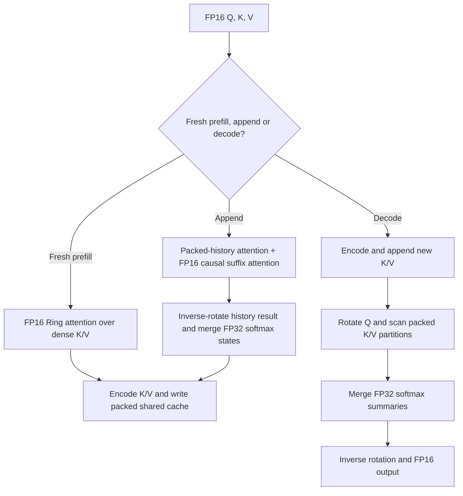
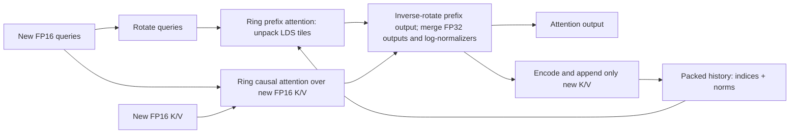

<!--
Copyright (C) 2026 Advanced Micro Devices, Inc. All rights reserved.
Licensed under the MIT License.
-->
# Experimental 4-bit TurboQuant KV cache

TurboQuant stores full-attention KV as four-bit centroid indices plus FP32 norms.
Fresh prefill uses FP16 Ring attention; decode scans packed KV directly; append
prefill combines packed history with the new prompt. Ring and TurboQuant compile
by default, and runtime selection is explicit. See the [setup guide](../../tools/turboquant/README.md)
for enablement and the [manual test guide](../../test/long_context/README.md) for reproduction.

This implementation is experimental. Kernel correctness over stored quantized
values and broad model answer quality are separate gates; the unresolved
[validation limits](#validation-and-known-limitations) remain in scope for review.

## Data flow

1. Compute prefill with the selected FP16 Ring implementation and dense K/V. The benchmark uses Ring-KV prefill. Prefill includes compression and writing the packed cache after attention in each full-attention layer.
2. Encode every new K/V vector into 256 four-bit centroid indices and one FP32 norm. Append into the shared cache without retaining a second persistent FP16 KV history.
3. For multi-token append prefill, attend to tiled packed history and causal FP16 new K/V, merge their softmax summaries, and then encode only the new rows. Existing packed rows are never rewritten.
4. For decode, append the new token, rotate the query, scan packed KV directly, merge partition summaries, inverse-rotate the result and produce FP16 output. There is no full-history dequantization buffer.



## Codec and allocation

The codec is `tq4_mse_qr_v1`, based on the supplied standalone `TurboQuantMSE` implementation. It assigns all four bits to MSE centroids. QJL correction bits, residual signs, training and adaptive codebooks are outside this implementation.

For a 256-wide vector `x`, compute its FP32 L2 norm `n`, normalize it, and apply the supplied orthogonal rotation `Pi`:

```text
z = (x / n) @ Pi.T
index[i] = nearest_centroid(z[i])
x_reconstructed = n * centroids[index] @ Pi
```

Zero vectors have zero norm and zero code bytes. Exact equal-distance ties select the lower centroid index. K and V have separate 16-entry codebooks and share one 256x256 rotation. The codec constants are loaded once per GQA operator state and freed with that state.

Each vector occupies **132 bytes**: a little-endian FP32 norm followed by 128 bytes containing two 4-bit indices each, lower index in the low nibble. Eight indices occupy each packed 32-bit code word. The norm precedes the codes. Compared with 512 bytes for FP16, the payload reduction is **512/132 = 3.8788x**. Constants, scratch and allocator padding are separate. Total model memory does not decrease by that factor.

GenAI 0.17 already supports `kvCacheQuantizationBits=4` for AMDGPU cache allocation. For head dimension 256, it creates a physical last dimension of **66 FP16 carrier elements**, equivalent to 132 bytes, rather than 256 dense elements. The graph still has the usual K and V cache tensors. Their contents are a versioned packed format, not ordinary FP16 values and not conventional linear INT4. No ONNX schema or GenAI cache-allocation change is needed. Multi-turn use with GenAI 0.17 requires the companion append-enablement patch described below.

Use these AMDGPU provider options together:

```json
{
  "kvCacheQuantizationBits": "4",
  "kv_cache_codec": "tq4_mse_qr_v1",
  "kv_cache_codec_file": "/absolute/path/to/codec.bin"
}
```

Use shared past/present buffers, an FP16 cache carrier type, symbolic or packed physical cache widths, and `past_present_share_buffer=true`. Decoder CPU fallback should be disabled during validation. `kvCacheQuantizationBits=0` or an absent option retains dense behavior; supplying a codec while quantization is disabled is rejected. Bit width alone never silently selects this codec.

The codec file has a 40-byte header: eight little-endian uint32 values (magic `0x34515448`, version 1, dimension 256, centroid count 16, rotation count 1, row bytes 132, flags 0, payload size) followed by an FNV-1a-64 payload checksum. The payload is FP32 row-major rotation, K centroids, V centroids. The runtime validates dimensions, size, checksum, finite values, increasing centroids and orthogonality. FNV is a corruption check, not an authentication mechanism; use trusted codec files. `tools/turboquant/write_codec.py` serializes exported constants without regenerating them.

## Runtime and compiler integration

The logical attention dimension and physical cache width are different. `GqaLowering` selects `wrap_group_query_attention_v4` for dynamic or packed widths and passes the actual four past/present K/V widths. Static dense shapes use main's optional-host-length ABI. The v4 packed-width entry also carries `has_host_length` and `host_length_value` before the four widths, so compiler-proven lengths avoid device readback on both dense and packed paths. Unproven lengths retain the runtime readback. Regenerate model artifacts produced against the earlier v3 entry. The v4 ABI also carries compiler-proven FP16 tensor eligibility, preventing BF16 from entering packed kernels. The v4 dense path validates widths and delegates to existing GQA.

The runtime checks geometry, feature flags, lengths, shared aliases, physical widths and overlapping ranges before encoding into the cache. It uses the EP stream and runtime-owned workspace. Codec errors and kernel failures propagate to an `OrtStatus`; the custom operator no longer reports successful output after a nonzero runtime return.

Supported experimental contract:

- Radeon `gfx1151`, Ring-enabled build, batch one, 24 query heads, four KV heads and head dimension 256.
- Separate FP16 Q/K/V; causal attention; external RoPE; scale 1/16; Q/output in BSHD and cache rows in BNSD order.
- Fresh or append prefill up to 131,072 new tokens per call, plus single-token decode; capacity and valid history at most 262,144. Full-model 256K prefill is not measured or admitted.
- Past/present K and V alias their corresponding buffers, with physical width 66. K/V caches cannot overlap each other or activations.
- No beams/batch expansion, internal rotary, attention bias, sinks, sliding windows, softcap, smooth softmax, QK output or conventional K/V quantization metadata.

The longer admission limits are experimental extensions beyond the parent Ring PR's 64K contract. Passing direct-kernel bounds checks does not override the failed full-model 256K numerical test.

## Kernel choices

Encoding uses one 256-thread workgroup per vector, FP32 norm reduction and rotation, and a 16-centroid search. Decode rotates Q once, shares each eight-token K/V tile across the six query heads in a KV group, and stages centroid values in FP16 for paired shared-memory loads. Norms, scores, softmax summaries and output accumulation remain FP32. FP16 centroid staging is an additional approximation that requires model-level qualification.

The history partition policy uses one partition through length 32, four through 128, eight through 1,024, and otherwise `ceil(length / 128)`. The merge has space for 2,048 partitions, including the 256K boundary. Both scan and merge use natural `expf`; scores and maxima are never converted to base-2 units.

The selected scan/merge adapts grouped-head reuse, shared-memory staging and history partitioning from GQA/Ring. It does not use distributed ring transport. `TQ4_REFERENCE_DECODE` retains a scalar control path for development comparisons.

### Append prefill

For a multi-token prompt with existing history, `hip_tq4_prefill` processes at
most 128 new queries per chunk. It rotates those queries in FP32 and stages
them in FP16. Power-of-two scaling protects rotated Q/K/V staging from
overflow on the tested finite-FP16 range; scores and values are restored in FP32. A specialization of the selected Ring prefill kernel unpacks
old K/V centroid indices and norms into small FP16 LDS tiles. Every old row
participates, but no full-history dense cache is materialized. A second Ring
specialization attends to the original FP16 new K/V with a causal mask offset
by the current query chunk. Earlier chunks of the same prompt remain dense
inputs until this whole append finishes.

Both passes return FP32 normalized value sums and natural-log softmax
normalizers. The join inverse-rotates the history result, then combines the
two results with stable weights proportional to their softmax normalizers.
It uses natural `expf`, not base-2 softmax. Only after all chunks finish does
the runtime encode the new K/V into the shared packed buffers. Single-token
calls keep the existing compressed decode path.

The explicit append scratch is `min(new_tokens, 128) * 24 * 2568` bytes:
FP16 rotated queries, two FP32 output buffers, and two FP32 log-normalizers.
The maximum is **7,888,896 bytes (7.5234 MiB)**, independent of history length.
This excludes input/output activations, per-workgroup LDS and retained runtime
allocator capacity. Persistent K/V remains 132 bytes per vector; neither the
ONNX cache layout nor the GenAI allocation contract changes.

FP16 rotated-query and reconstructed-K/V staging introduce additional rounding
relative to the FP32 decode path. The append tests compare against an FP64
oracle over the exact stored centroid indices and norms. This does not remove
the existing model-quality limitations or constitute a general FP16 extreme-
range qualification. New measurements must be recorded separately from the
historical single-turn tables.

### Why the Ring source changes

`ring_gqa.hip` supplies the tiled prefill computation for both parts of append:



`RingStatsCall<true>` reconstructs prefix tiles and returns FP32 output and
natural-log softmax statistics. `RingStatsCall<false>` returns the same statistics
for the causal dense tail. The join needs both to reproduce one softmax over the
combined prefix and tail. Reusing the existing Ring tile schedule avoids a second
copy of its WMMA, masking and LDS implementation.

The ordinary dense launch still instantiates `RingCall`: compile-time `stats` and
`packed` are false. Its K/V shape remains `past + query`, so the generalized scan
bound is the original dense bound. The extra packed load and statistics branches
are specialized away. Ring decode is unchanged by this extension. The 54-case
Ring numeric sanity suite passed on merge `6e39e12`; this documentation cleanup
makes no further kernel changes.

### Compiler and mock runtime

`GqaLowering.cpp` selects the versioned packed-width entry for packed or dynamic
cache shapes. The declaration, real runtime and mock runtime must expose the
same signature. `lib/Runtime/mock/mock_gpu.cpp` therefore supplies
`wrap_group_query_attention_v4` for GPU-free compiler/mock builds. It records
ordinary mock dispatch; it does not emulate compression or prove GPU accuracy.
There is no `mock_gpu.hip` in this PR.

### GenAI continuation

Repeated prompt append requires AMDGPU continuous decoding and flushing any
selected token whose KV has not been computed yet. This lifecycle requirement
applies to all three OGA modes. The [setup guide](../../tools/turboquant/README.md#external-dependencies)
owns the two companion patch choices, affected external files and exact SDK
provenance. HIP-EP does not require an ONNX schema or cache-allocation patch.

## Validation and known limitations

| Evidence | What it establishes | Remaining limit |
| --- | --- | --- |
| CPU codec and guarded HIP oracles | Packing, reconstruction, rotation, partition merge and arithmetic over stored indices/norms. | Strict CPU/GPU encoder parity historically fails at centroid boundaries: two code-byte differences in the 4K-vector gate. That assertion remains unchanged. |
| Mixed-cache append oracle | FP64 comparison, chunk/tile boundaries, bounded scratch, unchanged old rows and capacity admission. | FP16 staging adds rounding; this is not broad model-quality qualification. |
| Historical first-step/full-model checks | Some matching-prefix logits meet the numerical screen. | Greedy sequences diverge at several lengths; passing one-step logits does not guarantee answer agreement. |
| Historical synthetic 256K check | Kernel execution and decode timing at the cache boundary. | The first-decode screen failed: TurboQuant cosine 0.902733, relative L2 0.440642 versus baseline. Ring also failed that historical screen. No semantic 256K or full-model 256K prefill claim is made. |
| Codec provenance | Generated constants have a manifest and checksum. | Windows and historical Linux exports differ; codec identity must remain fixed for a cache. |

The historical evidence and original harnesses are preserved in
[the pre-cleanup revision](https://github.com/ROCm/hip-ep/tree/6e39e12cf2dec225adb72a593fab9493e25576f9/tools/turboquant)
and its [validation report](https://github.com/ROCm/hip-ep/blob/6e39e12cf2dec225adb72a593fab9493e25576f9/docs/design/turboquant-validation.md).
Those older binaries and measurements do not qualify current main. The
[recorded three-path performance report](turboquant-current-performance.md)
retains its exact source revision and machine-readable samples. Multi-turn
accuracy analysis and judge findings remain local pending author review.

Merge `6e39e12` sanity passed 692 compiler tests (nine unsupported), seven
selected runtime tests, 29 CPU tests, 54 Ring numeric cases and two host-length
numeric tests. These are scoped sanity checks, not a release-quality claim.

## Support files and measurement scope

| Area | Retained purpose |
| --- | --- |
| `tools/turboquant/` | Codec generation/reference and focused GPU/integration gates. |
| `tools/turboquant/benchmark/windows_memory_counter.cpp` | Optional process-local HIP allocation counter for timing campaigns. |
| `tools/turboquant/benchmark/windows_memory.py` | Reader used by `run_turboquant_performance.py`; the only remaining benchmark Python helper. |
| `test/long_context/` | Manual three-path model performance and multi-turn characterization; [file roles](../../test/long_context/README.md#support-files). |

The allocation sidecar records live EP device and mapped-host requested bytes,
including retained pools. It excludes driver allocations, CPU interpreter RAM
and physical residency. Weights, reserved KV and residual Other use this one
scope in the current performance report. Older WDDM commitment samplers and
four-way launchers are retired; their results are retained only as historical
evidence at the revision above. Keep `HIP_EP_PROFILE_ALLOCATOR_DLL` unset outside
profiling. Setup and [codec generation](../../tools/turboquant/README.md#generate-codec-assets-during-build-or-test-setup)
remain in the setup guide; no BIN/NPZ assets are committed.
