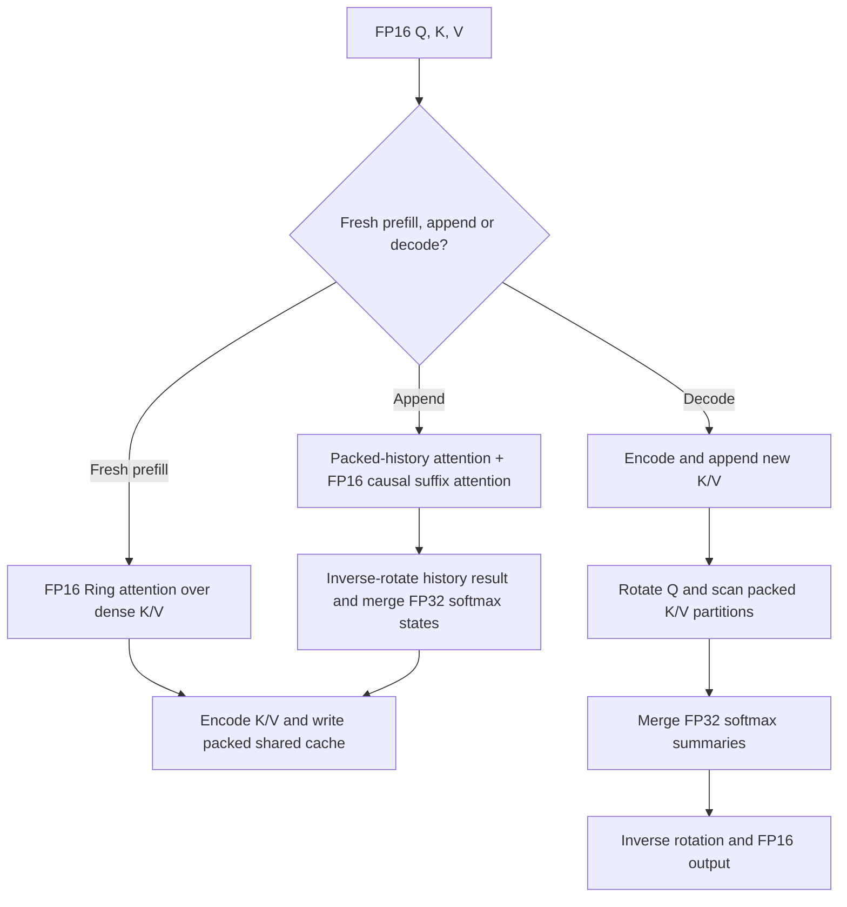

<!--
Copyright (C) 2026 Advanced Micro Devices, Inc. All rights reserved.
Licensed under the MIT License.
-->
# Experimental 4-bit TurboQuant KV cache

This opt-in implementation depends on [Ring attention PR #1252](https://github.com/ROCm/hip-ep/pull/1252). Merge that PR before this contribution and rebase onto main afterward. The parent is `63a00f5e35e54aff1d423525a9c8992fd8dea927`. Existing GQA remains the default build selection; enabling Ring alone does not enable KV compression.

The feature is **not ready for release**. Full-model generated sequences diverge at some tested prompt lengths even when first-step logits pass the numerical screen. The synthetic 256K comparison fails its numerical gate. Strict encoder parity has two centroid-boundary code-byte differences at 4K on Windows. The Windows codec export also differs from the frozen Linux artifact. See [measured validation](turboquant-validation.md) for results and limitations.

## Data flow

1. Compute prefill with the selected FP16 Ring implementation and dense K/V. The benchmark uses Ring-KV prefill. Prefill includes compression and writing the packed cache after attention in each full-attention layer.
2. Encode every new K/V vector into 256 four-bit centroid indices and one FP32 norm. Append into the shared cache without retaining a second persistent FP16 KV history.
3. For multi-token append prefill, attend to tiled packed history and causal FP16 new K/V, merge their softmax summaries, and then encode only the new rows. Existing packed rows are never rewritten.
4. For decode, append the new token, rotate the query, scan packed KV directly, merge partition summaries, inverse-rotate the result and produce FP16 output. There is no full-history dequantization buffer.



## Codec and allocation

The codec is `tq4_mse_qr_v1`, based on the supplied standalone `TurboQuantMSE` implementation. It assigns all four bits to MSE centroids. QJL correction bits, residual signs, training and adaptive codebooks are outside this implementation.

For a 256-wide vector `x`, compute its FP32 L2 norm `n`, normalize it, and apply the supplied orthogonal rotation `Pi`:

```text
z = (x / n) @ Pi.T
index[i] = nearest_centroid(z[i])
x_reconstructed = n * centroids[index] @ Pi
```

Zero vectors have zero norm and zero code bytes. Exact equal-distance ties select the lower centroid index. K and V have separate 16-entry codebooks and share one 256x256 rotation. The codec constants are loaded once per GQA operator state and freed with that state.

Each vector occupies **132 bytes**: a little-endian FP32 norm followed by 128 bytes containing two 4-bit indices each, lower index in the low nibble. Eight indices occupy each packed 32-bit code word. The norm precedes the codes. Compared with 512 bytes for FP16, the payload reduction is **512/132 = 3.8788x**. Constants, scratch and allocator padding are separate. Total model memory does not decrease by that factor.

GenAI 0.17 already supports `kvCacheQuantizationBits=4` for AMDGPU cache allocation. For head dimension 256, it creates a physical last dimension of **66 FP16 carrier elements**, equivalent to 132 bytes, rather than 256 dense elements. The graph still has the usual K and V cache tensors. Their contents are a versioned packed format, not ordinary FP16 values and not conventional linear INT4. No ONNX schema or GenAI cache-allocation change is needed. Multi-turn use with GenAI 0.17 requires the companion append-enablement patch described below.

Use these AMDGPU provider options together:

```json
{
  "kvCacheQuantizationBits": "4",
  "kv_cache_codec": "tq4_mse_qr_v1",
  "kv_cache_codec_file": "/absolute/path/to/codec.bin"
}
```

Use shared past/present buffers, an FP16 cache carrier type, symbolic or packed physical cache widths, and `past_present_share_buffer=true`. Decoder CPU fallback should be disabled during validation. `kvCacheQuantizationBits=0` or an absent option retains dense behavior; supplying a codec while quantization is disabled is rejected. Bit width alone never silently selects this codec.

The codec file has a 40-byte header: eight little-endian uint32 values (magic `0x34515448`, version 1, dimension 256, centroid count 16, rotation count 1, row bytes 132, flags 0, payload size) followed by an FNV-1a-64 payload checksum. The payload is FP32 row-major rotation, K centroids, V centroids. The runtime validates dimensions, size, checksum, finite values, increasing centroids and orthogonality. FNV is a corruption check, not an authentication mechanism; use trusted codec files. `tools/turboquant/write_codec.py` serializes exported constants without regenerating them.

## Runtime and compiler integration

The logical attention dimension and physical cache width are different. `GqaLowering` selects `wrap_group_query_attention_v2` for dynamic or packed widths and passes the actual four past/present K/V widths. Static dense shapes retain the existing ABI. The v2 dense path validates widths and delegates to existing GQA.

The runtime checks geometry, feature flags, lengths, shared aliases, physical widths and overlapping ranges before encoding into the cache. It uses the EP stream and runtime-owned workspace. Codec errors and kernel failures propagate to an `OrtStatus`; the custom operator no longer reports successful output after a nonzero runtime return.

Supported experimental contract:

- Radeon `gfx1151`, Ring-enabled build, batch one, 24 query heads, four KV heads and head dimension 256.
- Separate FP16 Q/K/V; causal attention; external RoPE; scale 1/16; Q/output in BSHD and cache rows in BNSD order.
- Fresh or append prefill up to 131,072 new tokens per call, plus single-token decode; capacity and valid history at most 262,144. Full-model 256K prefill is not measured or admitted.
- Past/present K and V alias their corresponding buffers, with physical width 66. K/V caches cannot overlap each other or activations.
- No beams/batch expansion, internal rotary, attention bias, sinks, sliding windows, softcap, smooth softmax, QK output or conventional K/V quantization metadata.

The longer admission limits are experimental extensions beyond the parent Ring PR's 64K contract. Passing direct-kernel bounds checks does not override the failed full-model 256K numerical test.

## Kernel choices

Encoding uses one 256-thread workgroup per vector, FP32 norm reduction and rotation, and a 16-centroid search. Decode rotates Q once, shares each eight-token K/V tile across the six query heads in a KV group, and stages centroid values in FP16 for paired shared-memory loads. Norms, scores, softmax summaries and output accumulation remain FP32. FP16 centroid staging is an additional approximation that requires model-level qualification.

The history partition policy uses one partition through length 32, four through 128, eight through 1,024, and otherwise `ceil(length / 128)`. The merge has space for 2,048 partitions, including the 256K boundary. Both scan and merge use natural `expf`; scores and maxima are never converted to base-2 units.

The selected scan/merge adapts grouped-head reuse, shared-memory staging and history partitioning from GQA/Ring. It does not use distributed ring transport. `TQ4_REFERENCE_DECODE` retains a scalar control path for development comparisons.

### Append prefill

For a multi-token prompt with existing history, `hip_tq4_prefill` processes at
most 128 new queries per chunk. It rotates those queries in FP32 and stages
them in FP16. Power-of-two scaling protects rotated Q/K/V staging from
overflow on the tested finite-FP16 range; scores and values are restored in FP32. A specialization of the selected Ring prefill kernel unpacks
old K/V centroid indices and norms into small FP16 LDS tiles. Every old row
participates, but no full-history dense cache is materialized. A second Ring
specialization attends to the original FP16 new K/V with a causal mask offset
by the current query chunk. Earlier chunks of the same prompt remain dense
inputs until this whole append finishes.

Both passes return FP32 normalized value sums and natural-log softmax
normalizers. The join inverse-rotates the history result, then combines the
two results with stable weights proportional to their softmax normalizers.
It uses natural `expf`, not base-2 softmax. Only after all chunks finish does
the runtime encode the new K/V into the shared packed buffers. Single-token
calls keep the existing compressed decode path.

The explicit append scratch is `min(new_tokens, 128) * 24 * 2568` bytes:
FP16 rotated queries, two FP32 output buffers, and two FP32 log-normalizers.
The maximum is **7,888,896 bytes (7.5234 MiB)**, independent of history length.
This excludes input/output activations, per-workgroup LDS and retained runtime
allocator capacity. Persistent K/V remains 132 bytes per vector; neither the
ONNX cache layout nor the GenAI allocation contract changes.

FP16 rotated-query and reconstructed-K/V staging introduce additional rounding
relative to the FP32 decode path. The append tests compare against an FP64
oracle over the exact stored centroid indices and norms. This does not remove
the existing model-quality limitations or constitute a general FP16 extreme-
range qualification. New measurements must be recorded separately from the
historical single-turn tables.

### GenAI continuation dependency

Stock GenAI 0.17 rejects repeated `Generator.append_tokens()` calls for the
AMDGPU cache device before invoking HIP-EP. The companion
[`onnxruntime-genai-0.17-amdgpu-append.patch`](../../tools/turboquant/patches/onnxruntime-genai-0.17-amdgpu-append.patch)
adds AMDGPU to the continuation capability list. It also makes standard
decoding evaluate a pending selected token before appending a new prompt;
otherwise the sequence length can advance ahead of the KV/recurrent state.
This is a GenAI source dependency, not a change to the packed cache format.
Rewind behavior is unchanged.

Build the patch against the GenAI `v0.17.0` release and use that package for
multi-turn tests. The local validation uses a separate package directory;
the installed stock package and original benchmark environments remain intact.
The patch includes a device-capability unit assertion; the exercised GPU
integration checks cover repeated append, a pending token, cache bytes and
resumed decode. See [append validation](turboquant-append-validation.md) for
the measured scope and any remaining gates.

## Validation and diagnostic memory accounting

The reference tests cover packing, reconstruction, rotation and partitioned attention. Direct HIP tests use guarded allocations, poisoned unused capacity and FP64 attention over the actual reconstructed packed data. The strict encoder byte gate is intentionally unchanged despite the documented boundary differences. The Windows GenAI test exercises shared-cache allocation, dense prefill, repeated append/decode transitions, preservation of old packed rows and invalid-codec rejection. `check_append.py` checks the mixed FP16/packed attention oracle, partial tiles, query-chunk boundaries, workspace admission and the 256K capacity boundary.

The optional Windows `HIP_EP_PROFILE_ALLOCATOR_DLL` hook loads a diagnostic allocation shim into ORC symbol lookup. The benchmark shim intercepts four HIP allocation/free APIs and records live EP device/mapped-host allocation sizes and event peaks. Leave the variable unset outside profiling. The independent Windows WDDM sampler measures process GPU commitment and includes mapped-host KV once; it is not physical residency. A controlled allocation/free/reuse check distinguishes retained HIP memory from live-user allocation totals.

The complete compiler/runtime/kernel integration is submitted together because the packed width, allocator contract, codec identity and decoder must agree. The feature remains explicit opt-in and draft while correctness gates are unresolved. No claim is made for other models, architectures, broad task accuracy or production readiness.
